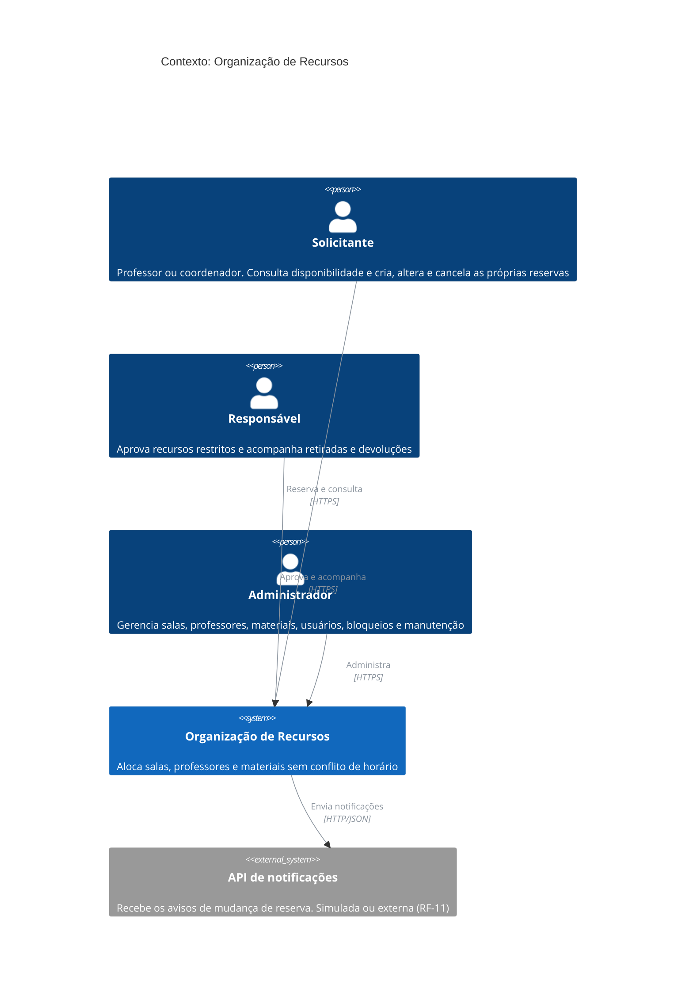
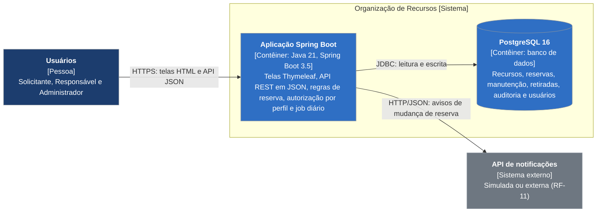
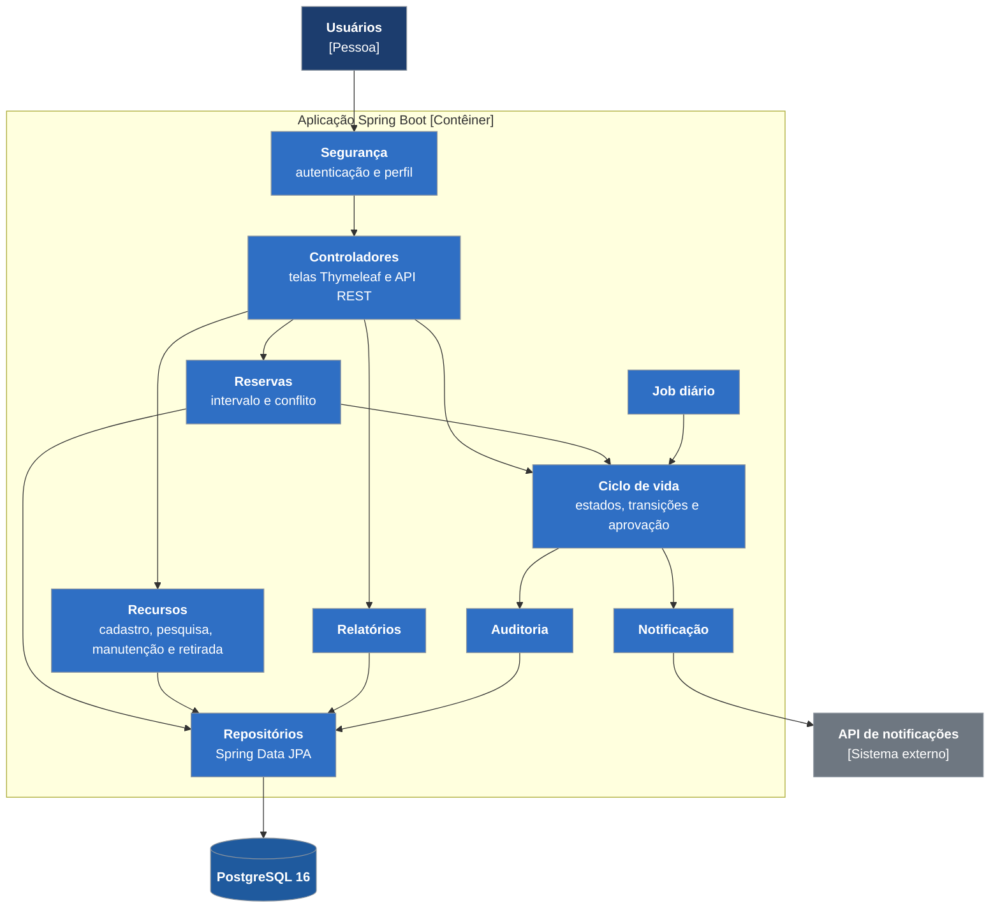
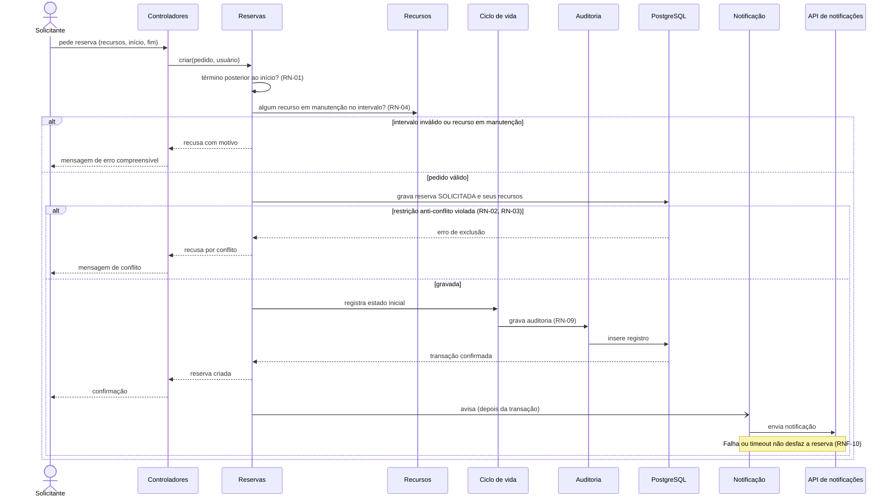
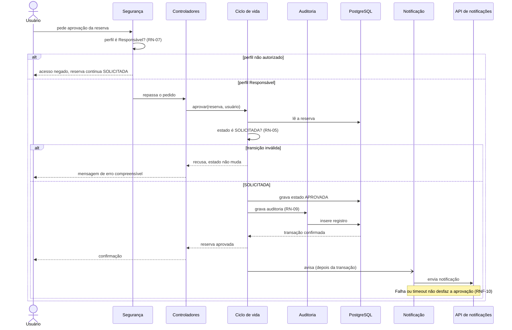
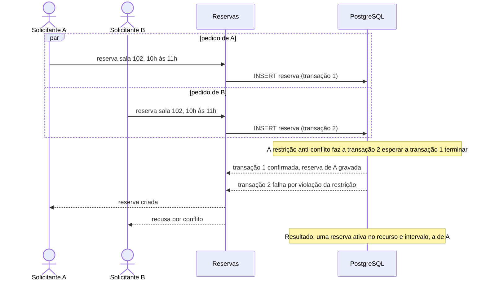
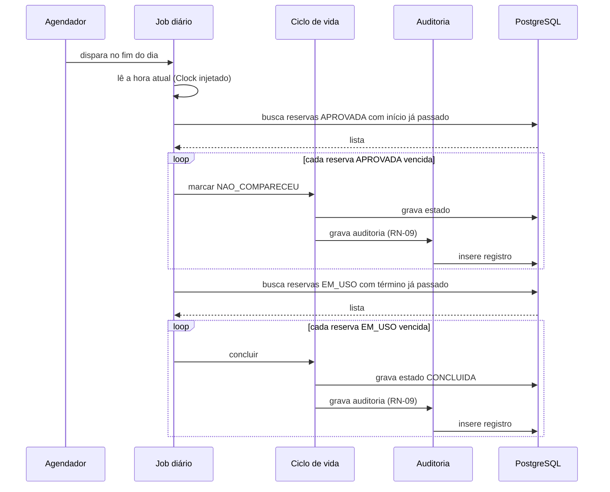
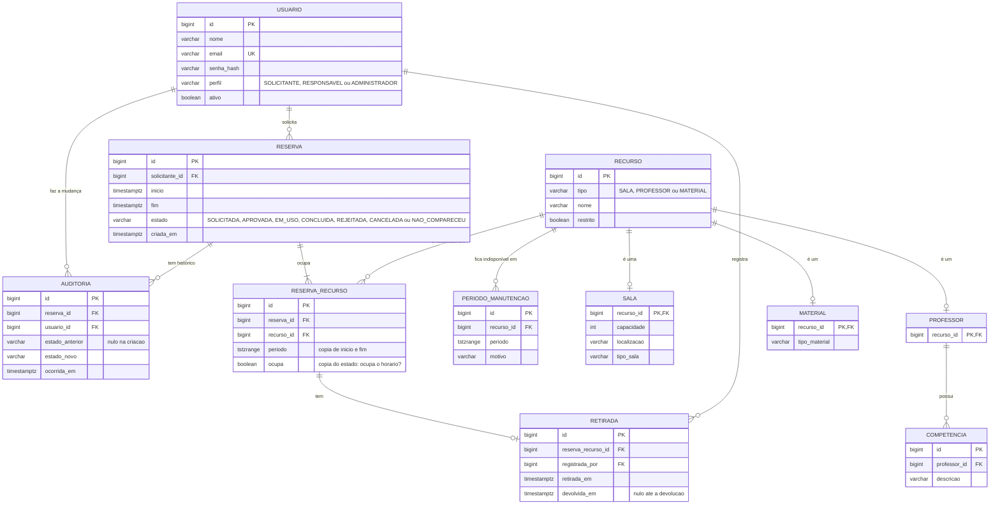

# Arquitetura: Organização de Recursos

> Esqueleto criado na semana 34 (Aula 03). Preenchido nas tasks T-10 a T-13 (semana 35).

## 1. Stack e descoberta

### 1.1 Stack

- Java 21 e Spring Boot 3.5 (Web, Security, Data JPA, Validation)
- PostgreSQL 16, com migrações Flyway
- Interface Thymeleaf + Bootstrap no mesmo projeto
- Testes: JUnit 5, Testcontainers, WireMock, Cucumber, JMeter
- Qualidade: GitHub Actions, JaCoCo, SonarCloud

### 1.2 Contexto e fonte de verdade

O sistema organiza a alocação de **salas, professores e materiais** de uma instituição de ensino sem conflitos de horário. O foco da disciplina é a evidência de qualidade, segurança, rastreabilidade e desempenho, não só o sistema funcionando.

- **Fonte de verdade dos requisitos:** [`prd.md`](prd.md), que por sua vez segue a [especificação oficial](https://afonsolelis.github.io/aulas_senac/pages/qualidade2/especificacao-projeto.html). Esta arquitetura preserva os IDs do PRD (RF-xx, RN-xx, RNF-xx, L-xx, DP-xx) e não cria requisitos novos: o que for suposição ou decisão de projeto recebe ID próprio (S-xx, D-xx).
- **Análise de qualidade:** a [utility tree](atam/utility-tree-inicial.md) já tem 8 folhas e 3 cenários detalhados. A T-12 a completa; este documento não a repete.

### 1.3 Stakeholders

| Perfil | Persona (fictícia) | O que precisa do sistema |
|---|---|---|
| Solicitante | Marina Couto | Consultar disponibilidade e criar, alterar e cancelar as próprias reservas |
| Responsável | Rogério Lima | Aprovar recursos restritos, validar a alocação de docentes e acompanhar retiradas e devoluções |
| Administrador | Patrícia Nogueira | Gerenciar salas, professores, materiais, usuários, bloqueios e manutenção |
| Professor da disciplina | — | Avaliar evidências de qualidade, segurança e rastreabilidade; fiscalizar os limitadores de nota |
| Time (Renata, Samuel, Caio) | — | Entregar, defender na prova oral e manter o código que cada um escreveu |

### 1.4 Fatos

Observados no repositório em 31/10/2026. Nenhum é decisão: são o ponto de partida.

| ID | Fato | Onde se confirma |
|---|---|---|
| F-01 | Java 21, Spring Boot 3.5.16, PostgreSQL 16 e Flyway | `pom.xml`, `compose.yaml` |
| F-02 | Só existe o esqueleto: a classe principal e 2 testes de contexto. Não há entidade, endpoint nem migração | `src/` |
| F-03 | O esquema do banco é responsabilidade do Flyway; o Hibernate só valida (`ddl-auto=validate`) | `application.properties` |
| F-04 | Horários ficam em UTC no banco; a conversão de fuso é na borda (API e telas) | `application.properties` |
| F-05 | `open-in-view` está desligado: consultas lazy não funcionam fora da transação | `application.properties` |
| F-06 | Os testes de integração usam PostgreSQL real via Testcontainers, nunca H2 | `TestcontainersConfiguration` |
| F-07 | O Spring Security está no classpath sem configuração: hoje a aplicação sobe com senha gerada e sem perfis | saída de `./mvnw verify` |
| F-08 | Não existe pipeline de CI | ausência de `.github/workflows` |

### 1.5 Drivers priorizados

Os drivers são os requisitos que mais pesam na arquitetura. A ordem vem do risco para a nota e do custo de errar tarde.

| # | Driver | Origem | Por que pesa |
|---|---|---|---|
| 1 | Nenhuma dupla reserva sob solicitações simultâneas | RN-03, RNF-05, F2 | Limitador de nota. É condição de corrida: só o banco garante |
| 2 | Nenhuma operação executada por perfil não autorizado | RN-07, RNF-06, F4, F5 | Limitador de nota. Precisa valer em todo ponto de entrada |
| 3 | Sem sobreposição no mesmo recurso, inclusive a agenda do professor | RN-02, RF-05, F1 | Regra central do produto; define o modelo de dados |
| 4 | Toda mudança de estado gera auditoria | RN-09, RF-10, F6 | Rastreabilidade; atravessa todas as transições |
| 5 | Falha da notificação não desfaz a reserva | RNF-10, RF-11, F7 | Isola uma dependência externa do fluxo principal |
| 6 | Desempenho da disponibilidade e da criação de reserva | RNF-09 (candidata) | Meta ainda não aprovada (DP-07) |

### 1.6 Suposições

Respostas provisórias às lacunas e decisões pendentes do PRD. **Nenhuma é regra oficial**: todas estão com validação pendente (com o professor, quando a especificação for omissa, e com o time) e podem mudar. A modelagem de dados (seção 3) parte delas.

| ID | Suposição | Responde a | Efeito no desenho | Status |
|---|---|---|---|---|
| S-01 | Reservas adjacentes não conflitam: uma que termina às 10h e outra que começa às 10h convivem. O período é fechado à esquerda e aberto à direita, `[início, fim)` | L01 · RN-02 | `tstzrange` com limites `[)` na restrição anti-conflito | Validação pendente |
| S-02 | Ocupam o horário os estados `SOLICITADA`, `APROVADA` e `EM_USO`. Não ocupam `REJEITADA`, `CANCELADA`, `NAO_COMPARECEU` e `CONCLUIDA` | L02 · RN-02, RN-03, RN-05, RN-06 | A restrição de exclusão vale só para os estados que ocupam (cláusula `WHERE`) | Validação pendente |
| S-03 | Todo recurso tem um indicador booleano `restrito`. Quando verdadeiro, a reserva exige aprovação do Responsável | L05 · RN-07, RF-07 | Coluna `restrito` na entidade de recurso | Validação pendente |
| S-04 | Bloqueio e manutenção são o mesmo mecanismo: um período de indisponibilidade do recurso, com motivo | L13 · RN-04, RF-08 | Uma só entidade de período de manutenção, sem tabela separada de bloqueio | Validação pendente |
| S-05 | Criar uma manutenção **não** cancela as reservas existentes: ela impede novas reservas e lista as reservas afetadas para o Administrador tratar | L14 · RN-04, FE-03 | Consulta de reservas afetadas; nenhum cancelamento em lote | Validação pendente |
| S-06 | Um job diário, no fim do dia, marca `NAO_COMPARECEU` nas reservas ainda `APROVADA` cujo horário de início já passou, e conclui as `EM_USO` vencidas | DP-01 · RN-06 | Fluxo batch com perfil de sistema; a sequência fica na seção 2 | Validação pendente |

### 1.7 Decisões

Decisões de projeto desta arquitetura. Cada uma cita o requisito de origem. Decisões que viram ADR são formalizadas na T-13.

| ID | Decisão | Origem | Alternativas consideradas | Custo assumido | Status |
|---|---|---|---|---|---|
| D-01 | `SOLICITADA` ocupa o horário, como em S-02 | RN-02, RN-03 · premissa do CEN-01 na utility tree | (a) só `APROVADA` e `EM_USO` ocupam; (b) `SOLICITADA` também ocupa | Em (b), um pedido pendente de aprovação "segura" o recurso e o solicitante pode bloquear horários. Em (a), duas solicitações simultâneas podem ser ambas aprovadas depois, o que reabre a dupla reserva (RNF-05). Escolhida a (b). Trade-off levado à T-12 | Aceita; validação pendente |
| D-02 | Uma reserva se liga aos seus recursos pela tabela `reserva_recurso`, em vez de um `recurso_id` único na reserva | RN-02, RF-05 · agenda do professor | (a) `recurso_id` único na reserva; (b) tabela `reserva_recurso` | Em (a), uma reserva só ocupa um recurso, e reservar sala e professor juntos exige várias reservas ligadas. Em (b), uma reserva ocupa sala, professor e material ao mesmo tempo, mas o `EXCLUDE` do PostgreSQL só enxerga colunas da própria tabela: o período e o indicador de ocupação são copiados para `reserva_recurso` e precisam ficar sincronizados com o estado da reserva. Escolhida a (b). Risco levado à T-12 | Aceita; validação pendente |

### 1.8 Lacunas ainda abertas

Lacunas e decisões pendentes do [PRD](prd.md#48-lacunas) que as suposições S-01 a S-06 **não** respondem. Elas não bloqueiam a arquitetura, mas cada uma tem um ponto em que será resolvida. As respondidas por S-xx (L01, L02, L05, L13, L14 e DP-01) não aparecem aqui.

| ID | Lacuna ou decisão pendente | Efeito na arquitetura | Onde será resolvida |
|---|---|---|---|
| L03 | O que é "simultâneo" e que resposta recebe a solicitação recusada | Quem decide o vencedor é o banco, pela restrição anti-conflito. A forma da resposta (código e mensagem) fica em aberto | T-37 |
| L04 | A reserva de um recurso não restrito passa por `APROVADA`? | Define as transições permitidas e se `SOLICITADA` vai direto a `APROVADA` | T-21 (spec do ciclo de vida) |
| L06 | Não existe matriz oficial de perfil × operação | A autorização por operação não pode ser detalhada ainda | T-48, T-49 |
| L07 | Conteúdo mínimo do registro de auditoria | Define as colunas da tabela de auditoria (seção 3) | T-40 |
| L08 | O que acontece com a reserva quando a notificação falha | A utility tree propõe que a reserva se mantenha; a notificação fica isolada do fluxo da reserva | T-31 |
| L09 | Notificações pendentes precisam ser reenviadas? | Reenvio está fora de escopo (FE-05); não há fila de reprocessamento | — |
| L10 | O coordenador tem permissões além das do professor no perfil Solicitante? | Nenhum efeito: os dois são o mesmo perfil (FE-02) | — |
| L11 | Até quando uma reserva pode ser alterada ou cancelada; cancelar uma reserva iniciada conta como "apagar"? | Interage com RN-08: reserva iniciada nunca é removida do banco | T-21 |
| L12 | O que significa "validar a alocação de docentes" para o Responsável | Pode exigir uma aprovação explícita da agenda do professor, com efeito no modelo | Sem task definida no PRD |
| DP-02 | Quais perfis consultam a auditoria | Afeta a autorização do acesso ao histórico | T-40, T-48 |
| DP-03 | Quais eventos disparam notificações | Define o contrato com a API externa | T-31 |
| DP-04 | Quem registra retirada e devolução | Afeta a autorização e o modelo de retirada | T-42 |
| DP-05 | Se o Administrador cria reservas | Afeta a matriz de autorização | T-48 |
| DP-06 | Relação entre "solicitação especial" e "recurso restrito" | Pode exigir um segundo mecanismo de aprovação além do campo `restrito` (S-03) | T-33, T-34, a decidir com o professor |
| DP-07 | Valores finais de desempenho | Define a meta que a arquitetura precisa atender (RNF-09) | T-38 |
| DP-08 | Timeouts da integração externa | Parâmetros configuráveis da integração, nunca fixos no código | T-31 |

### 1.9 Glossário

Termos usados neste documento, com o sentido que têm no sistema. Quando o termo vem de uma suposição, o ID aparece na definição.

| Termo | Significado |
|---|---|
| Recurso | Sala, professor ou material que pode ser reservado |
| Recurso restrito | Recurso cuja reserva exige aprovação do Responsável (RN-07). É marcado por um indicador booleano `restrito` (S-03) |
| Reserva | Pedido de uso de um ou mais recursos em um intervalo de tempo, feito por um Solicitante. Tem um estado |
| Intervalo | Período de uma reserva, de início a término. O término é posterior ao início (RN-01) e o intervalo é fechado no início e aberto no término (S-01) |
| Sobreposição | Dois intervalos que compartilham algum instante no mesmo recurso. Reservas adjacentes, uma terminando quando a outra começa, não se sobrepõem (S-01) |
| Estado que ocupa o horário | Estado em que a reserva impede outras no mesmo recurso e intervalo: `SOLICITADA`, `APROVADA` e `EM_USO` (S-02, D-01) |
| Fluxo principal | `SOLICITADA → APROVADA → EM_USO → CONCLUIDA` (RN-05) |
| Estados alternativos | `REJEITADA`, `CANCELADA` e `NAO_COMPARECEU` (RN-06) |
| Dupla reserva | Duas reservas ativas para o mesmo recurso e intervalo. É um limitador de nota e o que a restrição anti-conflito do banco impede (RNF-05) |
| Período de manutenção | Intervalo em que um recurso está indisponível, com motivo. Equivale ao bloqueio (S-04) e impede novas reservas (RN-04), sem cancelar as existentes (S-05) |
| Reserva afetada | Reserva já existente cujo intervalo cruza um período de manutenção. É listada para o Administrador (S-05) |
| Retirada e devolução | Registro de que um material ou equipamento saiu e voltou (RF-09) |
| Auditoria | Registro gravado a cada mudança de estado de uma reserva (RN-09) |
| Job diário | Processo agendado que marca `NAO_COMPARECEU` e conclui reservas vencidas (S-06) |
| Perfil | Papel de acesso de um usuário: Solicitante, Responsável ou Administrador (RF-01) |
| Solicitante | Perfil de quem cria, altera e cancela as próprias reservas. Professores e coordenadores são do mesmo perfil (FE-02) |
| Responsável | Único perfil que aprova recursos restritos (RN-07) |
| Administrador | Perfil que gerencia cadastros, usuários, bloqueios e manutenção |
| Conflito evitado | Tentativa de reserva recusada por sobreposição ou manutenção. Entra no relatório de utilização (RF-12) |

## 2. Diagramas C4 e camadas

Os diagramas seguem o modelo C4 em três níveis (contexto, contêineres e componentes), em Mermaid, para renderizar direto no GitHub. As sequências críticas vêm depois dos três níveis.

### 2.1 Nível 1: contexto

Mostra o sistema como uma caixa só, as pessoas que o usam e os sistemas externos com que conversa.



**Leitura do diagrama:**

- Os três perfis falam com o sistema pelo navegador (telas Thymeleaf) ou diretamente pela API. A autenticação por perfil vale nos dois caminhos (RF-01).
- A única dependência externa é a API de notificações. Ela é isolada do fluxo da reserva (RNF-10) e, nos testes, é simulada com WireMock.
- O banco de dados e o job diário não aparecem aqui porque estão dentro do sistema. Eles entram no nível de contêineres (2.2).

### 2.2 Nível 2: contêineres

Abre a caixa do sistema e mostra o que roda dentro dela. "Contêiner" aqui é uma unidade executável ou de armazenamento (um processo ou um banco), não um contêiner Docker.



**Leitura do diagrama:**

- **Dois contêineres próprios.** Telas e API ficam no mesmo projeto Spring Boot (ver 1.1): não há um front-end separado. A decisão de autenticação (sessão nas telas e token na API) será formalizada em ADR na T-13.
- **O banco é a última linha de defesa.** A restrição anti-conflito (D-02, S-01 e S-02) vive no PostgreSQL, não no código da aplicação. É isso que garante uma única reserva aceita sob solicitações simultâneas (driver 1).
- **Migrações pela aplicação.** O Flyway aplica as migrações quando a aplicação sobe (F-03). O Hibernate só valida o esquema.
- **O job diário não é um contêiner à parte.** Ele roda como tarefa agendada dentro do mesmo processo da aplicação (S-06) e aparece como componente no nível 3.
- **Notificação isolada.** A chamada à API externa acontece depois da reserva gravada, com timeouts configuráveis (RNF-10, DP-08). Nos testes, ela é simulada com WireMock.

### 2.3 Nível 3: componentes

Blocos internos da aplicação Spring Boot. Ainda não há código: os nomes são a proposta de organização e podem mudar nas specs.



| Componente | Responsabilidade | Requisitos |
|---|---|---|
| Segurança | Autentica e autoriza por perfil em toda entrada | RF-01, RN-07, RNF-06 |
| Controladores | Recebem pedidos, validam a entrada e devolvem erros sem detalhes internos | RF-13, RF-14, RNF-07, RNF-08 |
| Reservas | Cria, altera e cancela; valida o intervalo e detecta sobreposição | RF-04, RF-05, RF-06, RN-01 a RN-03 |
| Ciclo de vida | Único ponto de mudança de estado; inclui a aprovação de recurso restrito | RF-07, RN-05 a RN-08 |
| Recursos | Cadastro e pesquisa de salas, professores e materiais; manutenção; retirada e devolução | RF-02, RF-03, RF-08, RF-09, RN-04 |
| Relatórios | Utilização, carga horária alocada e conflitos evitados | RF-12 |
| Auditoria | Registro a cada mudança de estado | RF-10, RN-09 |
| Notificação | Avisos à API externa, sem desfazer a reserva se falhar | RF-11, RNF-10 |
| Job diário | Marca `NAO_COMPARECEU` e conclui reservas vencidas | S-06 |
| Repositórios | Acesso ao PostgreSQL; a restrição anti-conflito vive no banco | RNF-05, D-02 |

Como toda mudança de estado passa pelo Ciclo de vida, é ele que aciona a Auditoria e a Notificação, e a RN-09 não depende de cada chamador.

### 2.4 Sequências críticas

#### 2.4.1 Criar reserva



- O banco é quem decide o conflito. Se duas solicitações disputam o mesmo recurso e intervalo, só uma grava (S-01, S-02, D-02).
- A reserva e a auditoria entram na mesma transação. A notificação só sai depois da confirmação.
- Premissa, com validação pendente: a criação conta como mudança de estado e gera auditoria (RN-09). O que a recusa por conflito devolve ao usuário continua em aberto (L03).

#### 2.4.2 Aprovar recurso restrito



- A autorização é checada antes de chegar à regra. Um perfil diferente de Responsável nunca altera o estado (RN-07, RNF-06).
- A rejeição segue o mesmo caminho, com destino `REJEITADA` (RN-06). Quem rejeita ainda é uma necessidade candidata (NC-04).
- Premissa, com validação pendente: a notificação de aprovação (DP-03). Se uma reserva de recurso não restrito também passa por `APROVADA` continua em aberto (L04).

#### 2.4.3 Duas solicitações simultâneas

Dois Solicitantes pedem o mesmo recurso no mesmo intervalo ao mesmo tempo (CEN-02 da utility tree). Cada pedido roda em sua própria transação, depois de passar pelas validações da sequência 2.4.1.



- Quem vence é quem confirma primeiro. A ordem de chegada não importa, e a decisão é do banco, não do código da aplicação (S-01, S-02, D-02).
- A solicitação recusada não grava reserva ativa e não ocupa o horário (S-02).
- Sem a restrição no banco, uma checagem "existe conflito?" antes do INSERT deixaria as duas passarem. Por isso o teste de concorrência (T-37) é obrigatório.
- A forma da resposta recusada (código e mensagem) continua em aberto (L03).

#### 2.4.4 Job diário

Fluxo batch da S-06, disparado pelo agendador no fim do dia, dentro da própria aplicação.



- O job passa pelo Ciclo de vida, como qualquer outra mudança de estado, e por isso também gera auditoria (RN-09).
- Cada reserva é tratada em sua própria transação. O que já foi marcado não é buscado de novo, então uma nova execução não duplica o trabalho.
- A hora vem do `Clock` injetado, para o teste poder simular o fim do dia sem esperar.
- Quem marca `NAO_COMPARECEU` é uma suposição, com validação pendente (S-06, DP-01).
- O job não envia notificações: os eventos que notificam ainda são uma decisão pendente (DP-03).

## 3. Modelo de dados

### 3.1 Diagrama de entidades

Sala, professor e material são tipos de **recurso**. Uma tabela `recurso` guarda o que é comum (tipo, nome, `restrito`), e cada tipo tem uma tabela com seus próprios dados. Assim, a reserva, a manutenção e a restrição anti-conflito apontam sempre para um só `recurso_id`.



**Onde cada requisito está no modelo:**

| Requisito | Entidades |
|---|---|
| RF-01 autenticação e perfil | `USUARIO` |
| RF-02, RF-03 cadastro e pesquisa | `RECURSO`, `SALA`, `PROFESSOR`, `COMPETENCIA`, `MATERIAL` (a disponibilidade vem de `RESERVA_RECURSO` e `PERIODO_MANUTENCAO`) |
| RF-04, RF-07 reservas e aprovação | `RESERVA`, `RECURSO.restrito` |
| RF-05, RF-06 sobreposição e simultaneidade | `RESERVA_RECURSO` (restrição na seção 3.2) |
| RF-08 manutenção | `PERIODO_MANUTENCAO` |
| RF-09 retirada e devolução | `RETIRADA` |
| RF-10 auditoria | `AUDITORIA` |
| RF-11 notificação | sem tabela: o aviso é enviado e não guardado (reenvio fora de escopo, FE-05) |
| RF-12 relatórios | consultas sobre `RESERVA`, `RESERVA_RECURSO` e `AUDITORIA` |
| RF-13, RF-14 interface e documentação | sem tabela |

### 3.2 Restrições do banco

O banco é a última linha de defesa: as regras que protegem os limitadores de nota valem mesmo que o código da aplicação erre ou seja contornado.

| # | Restrição | Onde | Garante |
|---|---|---|---|
| 1 | Sem sobreposição: `EXCLUDE USING gist (recurso_id WITH =, periodo WITH &&) WHERE (ocupa)` | `RESERVA_RECURSO` | RN-02, RN-03, RNF-05 |
| 2 | Término posterior ao início: `CHECK (fim > inicio)` | `RESERVA` | RN-01 |
| 3 | Estado, perfil e tipo só aceitam os valores válidos: `CHECK (... IN (...))` | `RESERVA`, `USUARIO`, `RECURSO` | RN-05, RN-06 |
| 4 | Manutenções do mesmo recurso não se sobrepõem: `EXCLUDE USING gist (recurso_id WITH =, periodo WITH &&)` | `PERIODO_MANUTENCAO` | RF-08 |
| 5 | Nenhuma reserva é apagada: as chaves estrangeiras usam `ON DELETE RESTRICT`, e o cancelamento só muda o estado | `RESERVA` e tabelas filhas | RN-08 |
| 6 | Auditoria só recebe inserções, sem alteração nem exclusão | `AUDITORIA` | RN-09 |
| 7 | Uma retirada por recurso reservado, e a devolução não vem antes da retirada: `UNIQUE (reserva_recurso_id)` e `CHECK (devolvida_em IS NULL OR devolvida_em >= retirada_em)` | `RETIRADA` | RF-09 |
| 8 | E-mail único por usuário e nome único por tipo de recurso: `UNIQUE (email)` e `UNIQUE (tipo, nome)` | `USUARIO`, `RECURSO` | RF-01, RF-02 |

**A restrição 1 em SQL** (a extensão `btree_gist` permite combinar igualdade e sobreposição no mesmo índice):

```sql
CREATE EXTENSION IF NOT EXISTS btree_gist;

ALTER TABLE reserva_recurso
    ADD CONSTRAINT sem_sobreposicao
    EXCLUDE USING gist (recurso_id WITH =, periodo WITH &&)
    WHERE (ocupa);
```

- O período é `tstzrange` com limites `[)` (S-01), então reservas adjacentes não conflitam.
- A coluna `ocupa` é verdadeira nos estados `SOLICITADA`, `APROVADA` e `EM_USO` (S-02), e o Ciclo de vida a atualiza na mesma transação que muda o estado da reserva. Reservas em outros estados saem da restrição e liberam o horário.
- Alternativa descartada: bloquear a linha ou usar o nível de isolamento `SERIALIZABLE`. As duas dependem de cada trecho do código lembrar de usá-las, e um esquecimento reabre a dupla reserva.

**Limites conhecidos, levados à T-12:**

- **`ocupa` é uma cópia do estado.** Se o Ciclo de vida mudar o estado e esquecer de atualizar `ocupa`, o banco passa a divergir da reserva (D-02).
- **Reserva contra manutenção (RN-04)** não cabe em uma restrição declarativa, porque envolve duas tabelas. A verificação fica na aplicação (sequência 2.4.1). Há uma janela de corrida entre criar uma manutenção e criar uma reserva ao mesmo tempo. Um gatilho no banco seria a alternativa, a decidir.
- **Auditoria só de inserção** é garantida pela aplicação. Reforçar por permissão do banco ou por gatilho fica em aberto (L07).

## 4. Autenticação e sessão

TODO (T-13, T-15)

## 5. Decisões (ADR)

As decisões ficam em [`docs/adr/`](adr/). TODO (T-13): ADRs de arquitetura e matriz requisito → decisão → componente → evidência.


## 6. Análise ATAM

Avalia a arquitetura contra os atributos de qualidade que importam para a nota. Parte da [utility tree inicial](atam/utility-tree-inicial.md) (T-05, folhas F1 a F8, cenários CEN-01 a CEN-03) e a completa com o que as seções 2 e 3 revelaram. O catálogo usado nas táticas está em [`taticas-arquiteturais-len-bass.md`](taticas-arquiteturais-len-bass.md).

### 6.1 Utility tree

Escala (I, D): **A**lta, **M**édia, **B**aixa. I = importância para o negócio; D = dificuldade de alcançar. A análise começa pelas folhas (A, A).

Os IDs F1 a F8 são os da T-05. As origens agora usam os IDs do PRD, que não existiam na T-05. F9 a F14 são novas.

| ID | Atributo → refinamento | Folha (estímulo → resposta) | Origem | (I, D) | Justificativa |
|---|---|---|---|---|---|
| F1 | Adequação funcional → correção | Pedido que se sobrepõe a outra reserva do mesmo recurso é recusado e nada é gravado | RN-02, RF-05 | (A, A) | I: regra central do produto. D: três tipos de recurso, inclusive a agenda do professor, e a fronteira entre intervalos (S-01) |
| F2 | Adequação funcional → correção | Solicitações simultâneas do mesmo recurso e intervalo: só uma é aceita | RN-03, RNF-05 | (A, A) | I: dupla reserva é limitador de nota. D: condição de corrida, que só o banco resolve e só teste de concorrência prova |
| F3 | Adequação funcional → correção | Transição de estado inválida (por exemplo, `SOLICITADA` direto para `EM_USO`) é recusada | RN-05, RN-06 | (A, M) | I: pular a aprovação corrompe o ciclo de vida. D: transições são finitas e verificáveis por tabela |
| F4 | Segurança → integridade | Quem não é Responsável tenta aprovar recurso restrito: recusado, estado não muda | RN-07, RF-07 | (A, M) | I: falha de autorização é limitador de nota. D: a checagem precisa valer em todo ponto de aprovação |
| F5 | Segurança → integridade | Solicitante tenta operação do Administrador: negada, nada é alterado | RF-01, RNF-06 | (A, M) | I: limitador de nota. D: cobrir toda operação administrativa sem esquecer nenhuma (L06) |
| F6 | Segurança → responsabilização | Toda mudança de estado grava um registro de auditoria | RN-09, RF-10 | (A, M) | I: rastreabilidade. D: vale para todas as transições, inclusive as do job diário |
| F7 | Confiabilidade → tolerância a falhas | A API de notificações falha ou demora: a reserva se mantém e o erro não vaza | RNF-10, RF-11 | (A, A) | I: falha externa não pode derrubar a reserva. D: timeout e HTTP 500 só se reproduzem com simulação |
| F8 | Confiabilidade → recuperabilidade | Notificações falhas são reenviadas sem duplicar | FE-05 (fora de escopo) | (M, A) | Mantida só como registro: o reenvio está fora do escopo, e não vira cenário |
| F9 | Adequação funcional → correção | Reserva em recurso em manutenção é recusada, inclusive quando a manutenção e a reserva são criadas ao mesmo tempo | RN-04, RF-08 | (A, A) | I: regra crítica. D: envolve duas tabelas, então não cabe em restrição declarativa (seção 3.2) |
| F10 | Adequação funcional → integridade de dados | O indicador `ocupa` acompanha o estado da reserva em toda mudança | D-02, RN-02 | (A, M) | I: se divergir, a restrição anti-conflito deixa de proteger. D: é uma cópia mantida pelo Ciclo de vida |
| F11 | Eficiência de desempenho → comportamento temporal | Consulta de disponibilidade e criação de reserva sob 50 usuários simultâneos | RNF-09 (candidata) | (M, M) | I: meta ainda não aprovada (DP-07). D: depende de índices e do banco sob carga |
| F12 | Confiabilidade → recuperabilidade | O job diário falha no meio: uma nova execução termina o trabalho sem duplicar | S-06 | (M, M) | I: o job não é regra crítica oficial. D: falha parcial e reexecução precisam de tratamento por reserva |
| F13 | Eficiência de desempenho → capacidade | O job diário roda sem degradar as consultas online | S-06, RNF-09 | (M, M) | I: o job roda fora do horário de pico. D: disputa de banco entre batch e online |
| F14 | Segurança → confidencialidade | Um erro interno não devolve stack trace, SQL, nome de classe nem caminho | RNF-08 | (M, B) | I: exigido pela especificação. D: tratamento central de erros, simples de aplicar |

**Folhas (A, A), analisadas primeiro:** F1, F2, F7 e F9. F1, F2 e F7 já têm cenários na T-05 (CEN-01 a CEN-03). O F9 ganha o CEN-04 na seção 6.2.

### 6.2 Cenários (A, A) em seis partes

Os cenários das folhas F1, F2 e F7 foram escritos na T-05 e continuam valendo: [CEN-01](atam/utility-tree-inicial.md) (sobreposição), CEN-02 (solicitações simultâneas) e CEN-03 (falha da notificação). Aqui entra só o cenário que faltava, o da folha F9.

#### CEN-04 · Reserva e manutenção ao mesmo tempo (F9)

| # | Parte | Conteúdo |
|---|---|---|
| 1 | Fonte do estímulo | Um Administrador e um Solicitante, autenticados, agindo ao mesmo tempo |
| 2 | Estímulo | O Administrador cadastra uma manutenção da SALA-102 das 10h às 12h, e o Solicitante pede reserva da SALA-102 das 10h às 11h, no mesmo instante |
| 3 | Ambiente | Operação normal. A SALA-102 não tem reserva ativa nem manutenção nesse intervalo |
| 4 | Artefato | Componentes Reservas e Recursos (manutenção) e as tabelas `reserva_recurso` e `periodo_manutencao` no PostgreSQL |
| 5 | Resposta | O resultado é consistente em qualquer ordem. Se a manutenção confirma primeiro, a reserva é recusada (RN-04). Se a reserva confirma primeiro, ela fica gravada e aparece na lista de reservas afetadas pela manutenção, sem ser cancelada (S-05). Nenhuma reserva é gravada depois da manutenção confirmada |
| 6 | Medida da resposta | Em 20 execuções concorrentes, 0 reservas gravadas depois da confirmação da manutenção, e 100% das reservas confirmadas antes aparecem na lista de afetadas. Sem concorrência, uma reserva pedida depois da manutenção confirmada é recusada e nada é gravado. **Métrica candidata, validação pendente** |

- **Origem:** RN-04: "Recursos em manutenção não podem ser reservados." · RF-08 · suposições S-04 e S-05
- **Atributo / refinamento:** Adequação funcional → correção
- **(I, D):** (A, A) · **Justificativa:** I: regra crítica. D: a regra envolve duas tabelas e não cabe em restrição declarativa (seção 3.2)

| Campo | Conteúdo |
|---|---|
| Valor proposto | 20 execuções concorrentes |
| Status | Métrica candidata, validação pendente |
| Justificativa do número | Mesma ordem de grandeza do teste de concorrência de reservas (CEN-02), para reaproveitar a infraestrutura de teste |
| Impacto se o número estiver errado | Poucas execuções podem não revelar a janela de corrida, e muitas só alongam o teste |
| Quem aprova | Time, na spec do teste (T-35) |

### 6.3 Situações de falha

A Aula 04 lista situações de falha a considerar. Algumas são do pipeline de treino de modelo do case de aula (Foot Fanatics) e não existem no nosso sistema. Elas aparecem abaixo com o motivo, para ficar claro que foram avaliadas e não esquecidas.

| Situação | Aplica? | O que pode acontecer no nosso sistema | Folha | Como o desenho responde |
|---|---|---|---|---|
| Falha parcial do job | Sim | O job diário cai no meio e deixa reservas sem marcar | F12 | Cada reserva é tratada em sua própria transação (seção 2.4.4); o que já foi marcado fica salvo |
| Reexecução | Sim | O job roda de novo depois de uma falha, ou por engano | F12 | O job só busca `APROVADA` e `EM_USO` vencidas; o que já mudou de estado não é buscado de novo |
| Jobs sobrepostos | Sim | Duas execuções do job ao mesmo tempo tentam mudar a mesma reserva | F12, F3 | Depende de o Ciclo de vida recusar a transição quando o estado já mudou; não há bloqueio entre execuções (a avaliar) |
| Dados duplicados | Sim | O mesmo usuário envia o mesmo pedido duas vezes (duplo clique) | F1 | A segunda reserva conflita com a primeira e é recusada (S-02) |
| Dados atrasados | Não | Não há cache de disponibilidade nem fila de dados | — | Toda consulta lê o banco |
| Alteração de esquema | Sim | Uma migração Flyway falha ou quebra a restrição anti-conflito | F2, F10 | Migrações versionadas, aplicadas e testadas com PostgreSQL real (Testcontainers) |
| Degradação da qualidade dos dados | Não | Não há modelo treinado nem dados de entrada externos | — | — |
| Candidato inferior ao modelo ativo | Não | Não há modelo | — | — |
| Promoção incompleta | Adaptada | Uma transição de estado gravada sem o registro de auditoria | F6 | Estado e auditoria entram na mesma transação (seções 2.4.1 e 2.4.2) |
| Condições de rollback | Sim | A auditoria falha ao gravar; a notificação falha ao enviar | F6, F7 | A falha da auditoria desfaz a transição; a falha da notificação não desfaz nada (RNF-10) |
| Indisponibilidade do registro | Adaptada | O PostgreSQL fica indisponível | F14 | A aplicação não opera sem o banco; o erro devolvido não expõe detalhes internos (RNF-08) |
| Vazamento ou uso indevido de dados | Sim | Usuários, e-mails e histórico de reservas expostos a quem não deve ver | F4, F5 | Autorização por perfil em toda entrada; senha guardada só como hash (`senha_hash`); quem consulta a auditoria ainda é decisão pendente (DP-02) |
| Custo ou tempo acima da janela | Sim | O job diário demora mais do que o intervalo até a próxima execução | F13 | Sem medida ainda: o tamanho da janela e o volume esperado são lacunas |
| Impacto do batch no online | Sim | O job disputa o banco com consultas e reservas | F13 | O job roda no fim do dia e trata uma reserva por vez; a medida depende do teste de carga (T-38) |

### 6.4 Táticas e métricas

Cada abordagem da arquitetura, com a tática do [catálogo](taticas-arquiteturais-len-bass.md) que ela realiza, a métrica que a comprova, o custo e o teste planejado. Os testes ainda não existem: os IDs são das tasks que vão escrevê-los.

| Abordagem | Folha | Tática (Bass) | Métrica | Custo | Teste planejado |
|---|---|---|---|---|---|
| Restrição de exclusão no banco, na mesma transação que grava a reserva (2.4.3, 3.2) | F1, F2 | Transactions · Schedule Resources | 1 reserva ativa em 20 pedidos simultâneos (CEN-02); 21 de 21 verificações de sobreposição (CEN-01) | Contenção: a segunda transação espera a primeira, o que limita a vazão em pico | Concorrência (T-37) e sobreposição (T-23) |
| Ciclo de vida como ponto único de mudança de estado, com tabela de transições (2.3) | F3, F6 | Sanity Checking · Audit · Timestamp | 100% das transições inválidas recusadas; 1 registro de auditoria por mudança de estado | Um componente obrigatório no caminho; volume da tabela de auditoria | Ciclo de vida (T-21) e auditoria (T-40) |
| Segurança na frente de todas as entradas, com matriz de perfil por operação (2.3) | F4, F5 | Authenticate Actors · Authorize Actors | 0 operações por perfil não autorizado; 100% das células da matriz com o resultado esperado (RNF-06) | Complexidade do modelo de permissões | Matriz parametrizada (T-49) |
| Notificação depois da transação, com timeouts configuráveis (2.4.1) | F7 | Bound Execution Times · Exception Handling | 0 reversões de reserva com HTTP 500 ou timeout; timeouts de 500 ms e 1500 ms (candidatas, DP-08) | Notificação perdida, sem reenvio (FE-05) | WireMock (T-31) |
| Verificação de manutenção na aplicação, antes de gravar (2.4.1) | F9 | Sanity Checking | 0 reservas gravadas depois da manutenção confirmada, em 20 execuções (CEN-04, candidata) | A verificação e a gravação não são atômicas: a corrida não está fechada | Concorrência de manutenção (T-35) |
| Indicador `ocupa` atualizado pelo Ciclo de vida na mesma transação (3.2) | F10 | Transactions · Executable Assertions | 0 divergências entre `ocupa` e o estado da reserva após qualquer transição | Dado duplicado, que precisa ser mantido | Integração parametrizada por transição (T-21) |
| Job diário com uma transação por reserva e busca só de estados vencidos (2.4.4) | F12 | Transactions · Retry | 0 reservas marcadas duas vezes e 0 auditorias duplicadas após reexecução | Mais transações curtas | Job com `Clock` injetado e falha forçada no meio |
| Job rodando no fim do dia, uma reserva por vez (2.4.4) | F13 | Schedule Resources | p95 das consultas online com o job rodando dentro da meta de desempenho (candidata, MC-01) | Tempo total do job, ainda sem medida | Carga com o job em execução (T-38) |
| Tratamento central de erros nos controladores (2.3) | F14 | Exception Handling · Limit Exposure | 0 respostas de erro com stack trace, SQL, nome de classe ou caminho (RNF-08) | Mensagens menos detalhadas: o diagnóstico fica nos logs internos | Erros e entrada inválida (T-22, T-49) |
| **Nenhuma definida** | F11 | — | p95 ≤ 300 ms com 50 usuários (candidata, MC-01) | — | Carga (T-38) |

A última linha é um **risco**: o cenário de desempenho (F11) não tem tática nomeada. Ele volta na seção 6.5.

### 6.5 Descobertas

#### Pontos de sensibilidade

Um parâmetro que decide sozinho a resposta de **um** atributo.

| ID | Parâmetro | Atributo afetado | Efeito |
|---|---|---|---|
| PS-01 | Limites do intervalo, `[)` (S-01) | Adequação funcional | Decide se reservas adjacentes conflitam |
| PS-02 | Timeouts de conexão e leitura da notificação (MC-04, MC-05) | Confiabilidade | Decidem quanto tempo uma chamada externa presa consome recursos antes de falhar |
| PS-03 | Tamanho da janela e volume do job diário (sem medida) | Desempenho | Decidem se o job termina antes da próxima execução |

#### Pontos de trade-off

O mesmo parâmetro melhora um atributo e piora outro.

| ID | Decisão | Melhora | Piora |
|---|---|---|---|
| TO-01 | `SOLICITADA` ocupa o horário (D-01) | Integridade: duas solicitações não são aprovadas para o mesmo horário (RNF-05) | Usabilidade: um pedido pendente "segura" o recurso e outros ficam recusados |
| TO-02 | Restrição de exclusão no banco (3.2) | Integridade: dupla reserva impossível mesmo com erro no código | Desempenho: a segunda transação espera a primeira, e a vazão cai em pico |
| TO-03 | `reserva_recurso` com `ocupa` copiado do estado (D-02) | Adequação funcional: uma reserva ocupa sala e professor ao mesmo tempo | Modificabilidade: dado duplicado que precisa ser mantido em sincronia |

#### Riscos

Decisões que podem impedir um cenário de ser atendido.

| ID | Risco | Decisão de origem | Folha |
|---|---|---|---|
| R-01 | A verificação de manutenção e a gravação da reserva não são atômicas: uma reserva pode ser gravada depois de a manutenção ser confirmada | Verificação na aplicação (2.4.1, 3.2) | F9 |
| R-02 | `ocupa` diverge do estado da reserva se o Ciclo de vida esquecer de atualizá-lo, e a restrição anti-conflito deixa de proteger | D-02 | F10 |
| R-03 | Duas execuções do job ao mesmo tempo podem tentar mudar a mesma reserva, sem bloqueio entre elas | S-06, 2.4.4 | F12 |
| R-04 | Nenhuma tática de desempenho definida, e a meta ainda não foi aprovada | DP-07, RNF-09 | F11 |
| R-05 | A auditoria só de inserção depende da aplicação, sem reforço no banco | 3.2, restrição 6 | F6 |
| R-06 | O job diário não tem janela nem volume medidos | S-06, PS-03 | F13 |
| R-07 | Notificação perdida não é reenviada. **Risco aceito**: o reenvio está fora de escopo (FE-05) | RNF-10 | F7 |

#### Não-riscos

Decisões que atendem o cenário, com métrica verificável.

| ID | Não-risco | Por quê | Folha |
|---|---|---|---|
| NR-01 | A restrição de exclusão decide a corrida entre solicitações simultâneas | A decisão é do banco, e o CEN-02 mede 1 reserva em 20 pedidos (a comprovar no T-37) | F1, F2 |
| NR-02 | A falha da notificação não desfaz a reserva | A notificação sai depois da transação (2.4.1), e o CEN-03 mede 0 reversões | F7 |
| NR-03 | Perfil não autorizado não chega à regra de negócio | A Segurança fica na frente de toda entrada (2.3, 2.4.2) | F4, F5 |
| NR-04 | Nenhuma mudança de estado fica sem auditoria | Estado e auditoria entram na mesma transação (2.4.1, 2.4.2) | F6 |

#### Temas de risco

Padrões que se repetem em vários riscos.

| ID | Tema | Riscos |
|---|---|---|
| TR-01 | Regras que atravessam duas tabelas ou dois componentes dependem da disciplina do código, sem garantia do banco | R-01, R-02, R-05 |
| TR-02 | O job diário não tem medida nem proteção contra execução dupla | R-03, R-06 |
| TR-03 | Há cenário de desempenho e de job sem tática nem meta aprovada | R-04, R-06 |


## 7. Revisão cruzada

Cada papel questiona a arquitetura das seções 1 a 6. As objeções não são decisões: cada uma aponta onde será tratada (ADR, risco, pergunta aberta ou ação). A revisão é uma leitura crítica e deve ser contestada pelo time.

| Papel | Objeção | Onde é tratada |
|---|---|---|
| Analista | L12 ("validar a alocação de docentes") não tem task nem dono, e pode exigir uma aprovação que o modelo ainda não tem | Pergunta aberta |
| Analista | DP-06 pode separar "solicitação especial" de "recurso restrito", o que quebraria o campo único `restrito` (S-03) | Pergunta ao professor; ADR da entidade Usuario e do recurso |
| Arquiteto | O job diário roda dentro da aplicação: com duas instâncias, ele roda duas vezes (R-03) | R-03; ADR do job, se houver mais de uma instância |
| Arquiteto | A verificação de manutenção não é atômica com a gravação da reserva (R-01) | R-01 |
| Dados | `reserva` guarda `inicio` e `fim`, e `reserva_recurso` guarda `periodo`: são duas cópias do mesmo intervalo | Ação: definir qual é a fonte e sincronizar na mesma transação |
| Dados | Não há índice definido para a pesquisa de disponibilidade, e o desempenho (F11) depende dele | R-04; ADR do PostgreSQL |
| Segurança/LGPD | Nome e e-mail ficam em `usuario` e a auditoria guarda quem agiu: não há regra de retenção nem de quem consulta (DP-02) | Pergunta aberta; ADR da entidade Usuario |
| Segurança/LGPD | Sessão nas telas exige proteção contra CSRF, e o token da API precisa de validade; nada disso está definido | ADR de autenticação |
| Ops | Não há CI (F-08), e a extensão `btree_gist` precisa de permissão no banco para a migração rodar | ADR do Flyway; task do CI (T-25) |
| Ops | Nada avisa se o job diário falhar ou demorar (R-06) | R-06; sem ADR por ora |
| Custos | Não está definido onde a aplicação roda na entrega, e a API de notificações externa pode ter limite ou custo | Pergunta aberta |
| Custos | A pilha escolhida (PostgreSQL, Spring Boot, Thymeleaf) não tem licença paga; o custo é o tempo do time | Registrado nos ADRs como consequência |
