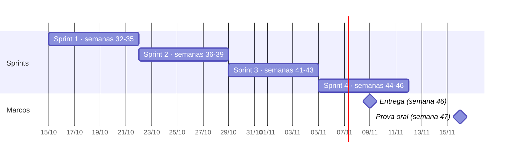

# Plano de sprints

O cronograma da disciplina vai da semana 32 à 47, mas o time começou em 15/10 (semana 42 do calendário). Por isso as **15 semanas de conteúdo foram comprimidas em 4 sprints de uma semana**. Cada sprint cobre as semanas do curso indicadas, na ordem das aulas, e todas as tasks estão no [backlog](backlog.md).

| Sprint | Período real | Semanas do curso | Foco |
|---|---|---|---|
| 1 | 15/10 a 21/10 | 32, 33, 34, 35 | Ambiente, diagnóstico, PRD, plano de teste, arquitetura e ATAM |
| 2 | 22/10 a 28/10 | 36, 37, 38, 39 | Autenticação, cadastros, TDD do núcleo de reservas, CI, JaCoCo, SonarCloud, Testcontainers e WireMock |
| 3 | 29/10 a 04/11 | 41, 42, 43 | BDD de aprovação e manutenção, concorrência, carga, auditoria, relatório e requisitos restantes |
| 4 | 05/11 a 11/11 | 44, 45, 46 | Interface, matriz de autorização, mutação, RTM, relatório de qualidade e entrega |
| — | a partir de 16/11 | 47 | Prova oral |

A semana 40 é a prova escrita (individual, sem entrega no projeto). As semanas 48 a 50 acontecem depois da entrega e ficam fora deste plano.

> O site do professor não traz datas exatas, só o número das semanas. As datas de entrega e da prova oral acima são estimativas pela semana do calendário: confirmem em sala ou no Discord.

## Rituais

- **Planejamento** (primeiro dia da sprint, 15 min): confirmar o objetivo, quem pega o quê e as dependências.
- **Check-in assíncrono** (diário, no grupo do time): o que fiz, o que vou fazer, o que me bloqueia.
- **Revisão** (último dia, 20 min): demonstrar o que foi mergeado e preencher o "Resultado" da sprint abaixo.

---

## Sprint 1 · 15/10 a 21/10 · semanas 32 a 35

**Objetivo:** ambiente de todos funcionando, projeto no repositório e a documentação de produto, teste e arquitetura que as specs vão citar.

| Pessoa | Tasks |
|---|---|
| Renata | T-02 Jira e proteção da main · T-03 diagnóstico · T-07 projeto Spring Boot · T-09 PRD |
| Samuel | T-06 plano de teste · T-08 AIOX · T-10 arquitetura e C4 · T-13 ADRs e matriz |
| Caio | T-04 personas · T-05 utility tree (Atividade #2) · T-11 modelo de dados · T-12 ATAM |
| Todos | T-01 ambiente de cada integrante |

**Ordem que importa:** T-07 (projeto) e T-02 (Jira e proteção) primeiro. Depois T-01 (cada um roda o projeto). T-04 (personas) antes de T-09 (PRD), e o PRD antes da arquitetura (T-10 a T-13).

**Pronto quando:** os 3 rodam `./mvnw verify` verde; `main` protegida; PRD com RF, RNF e RN numerados; arquitetura com C4, sequências, ATAM e ADRs mergeados.

**Resultado:** _a preencher na revisão da sprint_

---

## Sprint 2 · 22/10 a 28/10 · semanas 36 a 39

**Objetivo:** primeiras tasks pelo fluxo completo de specs. Autenticação, cadastros e núcleo de reservas por TDD, com CI, cobertura e análise estática ativos.

| Pessoa | Tasks |
|---|---|
| Renata | T-14 defeitos · T-19 plano TDD · T-20 red intervalo e sobreposição · T-23 green · T-28 cobertura de ramo · T-32 RTM |
| Samuel | T-15 autenticação (crítica) · T-17 professores · T-18 materiais · T-25 CI · T-29 SonarCloud · T-31 notificação WireMock |
| Caio | T-16 salas · T-21 red ciclo de vida · T-22 tratamento de erros · T-24 green · T-26 ciclo-01 · T-27 JaCoCo · T-30 Testcontainers |

**Ordem que importa:** T-25 (CI) e T-15 (autenticação) no início, porque quase tudo depende deles. T-19 (plano TDD) antes das fases red. Escrevam as specs no primeiro dia: a revisão leva tempo.

**Pronto quando:** CI com JaCoCo 80/70 e SonarCloud no PR; reserva com intervalo, sobreposição e estados implementada com commits `test(red)` e `feat(green)` no histórico; RTM iniciada.

**Riscos:** quem fizer a T-25 precisa do escopo `workflow` no token do GitHub (`gh auth refresh -h github.com -s workflow`). O secret `SONAR_TOKEN` só pode ser criado pela Renata (admin).

**Resultado:** _a preencher na revisão da sprint_

---

## Sprint 3 · 29/10 a 04/11 · semanas 41 a 43

**Objetivo:** fechar as regras que são limitadores de nota e os requisitos que nenhuma aula cobre.

| Pessoa | Tasks |
|---|---|
| Renata | T-36 Cucumber e evidência TDD · T-38 JMeter · T-39 status dos requisitos · T-40 auditoria (crítica) |
| Samuel | T-35 manutenção (crítica) · T-37 dupla reserva (crítica) · T-42 retirada e devolução · T-44 layout e login |
| Caio | T-33 BDD · T-34 aprovação (crítica) · T-41 relatório de utilização · T-43 pesquisa |

**Ordem que importa:** T-33 (BDD) antes de T-34 e T-35. T-37 (dupla reserva) antes de T-38 (carga) e T-41 (relatório).

**Pronto quando:** aprovação, manutenção, dupla reserva e auditoria com spec liberada, testes e PR mergeado; teste de concorrência estável em 5 execuções; resultado de carga documentado.

**Resultado:** _a preencher na revisão da sprint_

---

## Sprint 4 · 05/11 a 11/11 · semanas 44 a 46

**Objetivo:** interface completa, autorização provada, RTM fechada e entrega empacotada.

| Pessoa | Tasks |
|---|---|
| Renata | T-45 telas do Solicitante · T-50 mutação e RTM · T-52 relatório de qualidade · T-57 decisão de qualidade e formulário |
| Samuel | T-47 testes E2E · T-48 matriz de autorização · T-49 teste da matriz (crítica) · T-56 tag `v1.0.0-rc1` e evidências |
| Caio | T-46 telas do Responsável e do Administrador · T-51 OpenAPI · T-53 perguntas da prova oral · T-55 clone limpo e checklist |
| Todos | T-54 ensaio e apresentação · T-58 prova oral (semana 47) |

**Pronto quando:** metas 80/70 atingidas, RTM com 100% dos requisitos críticos, tag `v1.0.0-rc1` com CI verde e formulário enviado.

**Resultado:** _a preencher na revisão da sprint_
