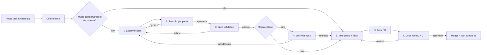

# AI Workflow: da task ao merge

Este documento descreve **o caminho de toda task**, do momento em que alguém a pega no [backlog](../planejamento/backlog.md) até o merge na `main`. O time não usa Jira ([ADR-0003](../adr/0003-retirar-o-jira-do-fluxo.md)). Ele vale para as três pessoas do time e para o Claude, que lê as mesmas regras pelo [`CLAUDE.md`](../../CLAUDE.md).

A ideia central é o **Spec-Driven Development**: nenhuma linha de código de produção é escrita antes de existir uma especificação revisada por outra pessoa, validada e confrontada com a documentação.

## Visão geral



## Quem revisa quem

A revisão é sempre feita por **outra pessoa**, em rodízio fixo, para que todos revisem e sejam revisados:

| Autor(a) da task | Revisa a spec e o PR |
|---|---|
| Renata | Samuel |
| Samuel | Caio |
| Caio | Renata |

Se o revisor estiver indisponível por mais de 24 horas, a terceira pessoa assume e isso é anotado no PR (campo **Revisor** do template). O rodízio temporário durante a ausência da Renata está no [CONTRIBUTING](../../CONTRIBUTING.md#time).

## Estados da task

Não há board. O estado de cada task aparece no próprio repositório:

| Estado | A task está aqui quando... | Onde se vê |
|---|---|---|
| **A fazer** | Ainda ninguém começou. | Não existe branch com o ID da task |
| **Spec** | O dono está escrevendo a spec. | Branch criada e spec em `docs/specs/` |
| **Revisão da spec** | A spec aguarda o parecer do revisor. | Status da spec `Em revisão` |
| **Pronta para dev** | A spec passou na validação (e no grill, se for crítica). | Status da spec `Liberada` |
| **Em desenvolvimento** | Ciclos de TDD em andamento. Tasks sem spec começam aqui. | Commits `test(red)`/`feat(green)` na branch |
| **Em revisão** | O PR foi aberto. | PR aberto no GitHub |
| **Concluída** | O PR foi mergeado com CI verde. | PR mergeado na `main` |

Tasks sem spec (fluxo `—` no backlog: documentação e infraestrutura) pulam direto de **A fazer** para **Em desenvolvimento**. Pendências e defeitos que surgirem no caminho viram issues no GitHub.

---

## Passo 0: pegar a task

1. No [`backlog.md`](../planejamento/backlog.md), pegue uma task da qual **você é o dono** e cuja dependência (coluna "Depende de") já esteja concluída, ou seja, com o PR mergeado.
2. Leia a task completa no mesmo arquivo.

## Passo 0.1: criar a branch

```bash
git checkout main
git pull
git checkout -b feature/T-23-criar-reserva
```

O padrão é `<tipo>/<ID-DA-TASK>-<descricao-curta>`. Os tipos e as regras completas estão no [CONTRIBUTING](../../CONTRIBUTING.md#nomes-de-branch). O ID da task no nome liga a branch, os commits e o PR à task do backlog.

**Na branch você pode commitar e dar push quantas vezes quiser.** O PR só é aberto no passo 6, quando a task estiver terminada.

## Passo 1: escrever a spec

- **Quem faz:** o dono da task.
- **Arquivo:** `docs/specs/T-23-criar-reserva.md`, copiado de [`_TEMPLATE.md`](../specs/_TEMPLATE.md).
- **Com o Claude:** rode `/iniciar-task`. Ele cria o arquivo a partir do template, puxa os requisitos do PRD e **faz perguntas**, mas quem decide as regras e escreve os critérios de aceite é você.

O que não pode faltar:
- requisitos e regras de negócio que a spec atende (RF e RN do PRD);
- o que está **fora** do escopo;
- contrato da API (endpoint, entrada, saída e erros);
- critérios de aceite numerados (`CA-01`, `CA-02`...) no formato **Dado / Quando / Então**;
- casos de teste ligados a cada critério (classes de equivalência e valor limite);
- mini-plano com os ciclos de TDD.

Ao terminar: mude o status da spec para `Em revisão`, faça commit e push e avise o revisor.

```bash
git add docs/specs/T-23-criar-reserva.md
git commit -m "docs(spec): cria spec de criação de reserva (T-23)"
git push -u origin feature/T-23-criar-reserva
```

## Passo 2: revisão por pares

- **Quem faz:** o revisor do rodízio, **nunca** o autor.
- **Como:** o revisor baixa a branch, lê a spec e preenche a seção **9. Revisão por pares** com o checklist e o parecer.
- **Com o Claude:** o revisor pode rodar `/revisar-spec` para levantar pontos, mas o parecer é dele e deve ser escrito com as próprias palavras.

```bash
git fetch
git checkout feature/T-23-criar-reserva
# preenche a seção 9
git commit -am "docs(spec): revisa spec de criação de reserva (T-23)"
git push
```

O commit de revisão fica com o nome do revisor no histórico. Essa é a **evidência de revisão por pares** que o professor pede.

- Parecer `Ajustes necessários`: o autor corrige e pede nova revisão.
- Parecer `Aprovada`: o autor muda o status da spec para `Aprovada`.

## Passo 3: spec validation

Validação automática da estrutura da spec. Quem roda é o autor:

```bash
./scripts/validar-spec.sh docs/specs/T-23-criar-reserva.md
```

O script confere, entre outros pontos: as seções obrigatórias, autor diferente do revisor, parecer `Aprovada`, critérios no formato Dado/Quando/Então, todo critério de aceite com pelo menos um caso de teste, mini-plano preenchido e ausência de trechos `_preencher_`.

- Passou: preencha a seção **10. Spec validation** com a data e mude o status para `Validada`.
- Falhou: corrija o que o script apontar e rode de novo.

Para tasks com fluxo `spec` (não críticas), a task vai agora para **Pronta para dev**, com o status `Liberada`.

## Passo 4: grill-with-docs (somente regras críticas)

Uma "sabatina" de 10 a 15 minutos em que o Claude **cruza a spec com toda a documentação** e faz perguntas difíceis, **uma de cada vez**:

```
/grill-with-docs docs/specs/T-23-criar-reserva.md
```

O Claude confere a spec contra:
- a [especificação da disciplina](../projeto/contexto-da-disciplina.md) (regras críticas e limitadores de nota);
- o PRD (RNs e escopo);
- a arquitetura e os ADRs;
- as outras specs (conflitos ou duplicações);
- a RTM (o requisito vai ficar rastreado?).

Exemplos de perguntas: *"A spec diz que o término deve ser posterior ao início. E se forem iguais? Qual CA cobre isso?"*, *"Qual ADR justifica usar lock pessimista?"*.

Quem responde é o **dono da task**, e o revisor pode participar. Perguntas e decisões ficam registradas na seção **11. Grill-with-docs**. Quando não houver pendências, o status vira `Liberada` e a task vai para **Pronta para dev**.

> Por que isso importa: o grill é um ensaio da **prova oral**. Se você não sabe responder agora, o professor também vai perceber.

## Passo 5: mini-plano e TDD

Siga o mini-plano da seção 8 da spec, **um ciclo por vez**:

1. **Red:** escreva o teste do ciclo, rode e veja **falhar pelo motivo certo**. Faça commit.
2. **Green:** escreva o mínimo de código para passar. Faça commit.
3. **Refactor:** melhore o código sem mudar o comportamento, com os testes verdes. Faça commit se houver mudança.

```bash
git commit -m "test(red): término anterior ao início é recusado (T-23)"
git commit -m "feat(green): término anterior ao início é recusado (T-23)"
git commit -m "refactor: extrai validação de intervalo (T-23)"
```

Os commits `test(red)` separados são a **evidência de TDD** que o professor procura no histórico (Aula 09). Formato completo no [CONTRIBUTING](../../CONTRIBUTING.md#commits-de-tdd). O CI roda só no PR e na `main`, então um commit vermelho na sua branch não quebra nada.

- **Com o Claude:** ele explica, revisa o teste e sugere a próxima etapa. **Você escreve as regras de negócio e os testes.** O Claude pode gerar código repetitivo (configuração, DTOs, mapeamentos), explicando cada parte.
- Se, durante o código, você descobrir que a spec estava errada: **pare, atualize a spec** e avise o revisor. A spec e o código precisam contar a mesma história.

## Passo 6: abrir o PR (só com a task terminada)

Antes de abrir, confira a **Definition of Done**:

- [ ] todos os critérios de aceite da spec têm teste passando;
- [ ] `./mvnw verify` verde na sua máquina;
- [ ] RTM atualizada com a linha do requisito (quando a `docs/rtm.md` existir);
- [ ] documentação afetada atualizada (README, arquitetura, ADR);
- [ ] branch atualizada com a `main` (`git pull origin main`).

Rode `/preparar-pr`: o Claude preenche o [template de PR](../../.github/pull_request_template.md) com base na spec e nos commits. Você revisa o texto e abre o PR:

```bash
gh pr create --title "T-23: criar reserva com validação de intervalo" --body-file /caminho/do/texto.md
```

Avise o revisor. Não abra PR em rascunho (*draft*) nem PR de task pela metade.

## Passo 7: code review e merge

- O revisor do rodízio revisa o código **no GitHub**, comentando nas linhas.
- O merge só é liberado com **1 aprovação** e **CI verde**. Essas regras devem ser garantidas pela proteção da `main`, que ainda está pendente ([CONTRIBUTING](../../CONTRIBUTING.md#a-branch-main)).
- Use **"Create a merge commit"**, e não *squash*: assim os commits red/green continuam visíveis como evidência de TDD.
- Quem faz o merge é o **autor**, depois da aprovação. Apague a branch: o merge é o que marca a task como **Concluída**. Se o PR resolve uma issue, o `Closes #N` do corpo a fecha automaticamente.

---

## O que o Claude faz e o que não faz

| Faz | Não faz |
|---|---|
| Explica conceitos e faz perguntas | Commit, push, merge, tag ou abrir PR |
| Monta arquivos a partir dos templates | Inventar regra de negócio que não está no PRD ou na spec |
| Revisa spec, testes e código | Escrever a regra de negócio e os testes no lugar do dono da task |
| Conduz o grill-with-docs | Começar código de task cuja spec não está `Liberada` |
| Sugere mensagens de commit e o texto do PR | Pular etapas do fluxo, mesmo que alguém peça para "ir mais rápido" |

## Comandos do Claude neste repositório

| Comando | Etapa | O que faz |
|---|---|---|
| `/iniciar-task` | 0 e 1 | Sugere o nome da branch, cria a spec a partir do template e conduz o preenchimento |
| `/revisar-spec` | 2 | Ajuda o revisor com o checklist de revisão |
| `/grill-with-docs` | 4 | Sabatina a spec contra toda a documentação e registra as decisões |
| `/preparar-pr` | 6 | Confere a Definition of Done e preenche o template de PR |

Os comandos ficam em `.claude/skills/`. O `scripts/validar-spec.sh` (etapa 3) é um script comum, que também poderá rodar no CI.
